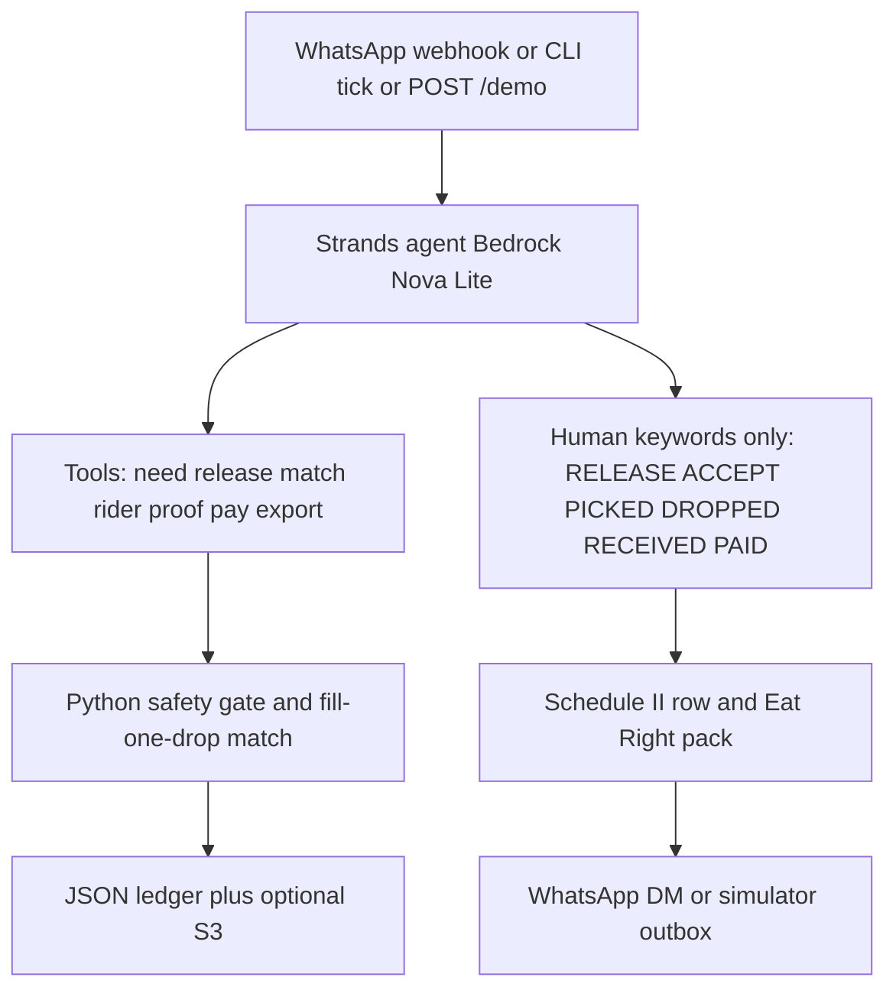

# AfterMess

Good Neighbor agent for **IIIT Delhi** leftover closeout. Two mess vendors (same campus), two named drops, a named rider roster. Food is **free unused leftover**. Drops pay only the rider on UPI. WhatsApp is the only user interface.

**Track:** Good Neighbor. Built with the **Strands Agents SDK** (Amazon Nova Lite on Bedrock). Safety, plate math, and the rider roster are Python. The model may parse messy text and draft copy. It cannot override a safety refuse.

License: **Apache-2.0** (`LICENSE`). Do not commit `.env`.

## Architecture



Mess, drop, and rider never use a web app. `GET /` is a judge button only.

## Run without AWS or WhatsApp (today)

```powershell
cd D:\AWS-Hackathon
py -3.12 -m venv .venv
.\.venv\Scripts\Activate.ps1
pip install -r requirements.txt
python -m unittest tests.test_aftermess
python -m aftermess demo
```

`demo` is the locked lunch script: Drop A needs 40 veg plates, Drop B needs 20, Mess A releases 15, Mess B releases 20, match fills Drop A with 35, rider 1 cancels, rider 2 accepts, pickup/drop/received/paid, Schedule II export.

Operator CLI (same keywords the live webhook uses):

```powershell
python -m aftermess reset
python -m aftermess inbound --party drop_a --text "NEED 40 LUNCH VEG" --sitting lunch --date 2026-09-08
python -m aftermess tick --sitting lunch --phase needs_cutoff --date 2026-09-08
python -m aftermess tick --sitting lunch --phase closeout --date 2026-09-08
python -m aftermess inbound --party mess_a --text "RELEASE 15 DISHES dal,rice VEG veg UNUSED yes PREP 2026-09-08T13:00:00+05:30 USEBY 2026-09-08T18:00:00+05:30 TEMP 65 PACKED yes INSULATED yes BATCH fresh-cooked PERISHABLE yes" --sitting lunch --date 2026-09-08
python -m aftermess tick --sitting lunch --phase match --date 2026-09-08
python -m aftermess status --sitting lunch --date 2026-09-08
python -m aftermess export --sitting lunch --date 2026-09-08
python -m aftermess outbox
```

OPEN campus clocks, rupee amount, WhatsApp numbers, and FSSAI ids live in `data/aftermess/directory.json` and `data/aftermess/config.json`. Fill them before a live run. Do not invent sitting times in code. If clocks are null, `tick` needs `--phase`.

## Live WhatsApp

Copy `.env.example` to `.env`. Set `WHATSAPP_PROVIDER=meta` or `twilio` and the matching tokens. Put real numbers on the directory. Utility template names in config stay null until the WABA is approved; until then the adapter sends free-form text (works inside an open 24h window and in the simulator).

```powershell
python -m aftermess webhook --port 8080
```

Meta verify URL: `GET /webhook`. Inbound: `POST /webhook`.

## Strands agent (needs a model)

```powershell
python -m aftermess run --sitting lunch --phase match
```

Default model is Amazon Nova Lite.

## Deploy live (judges + WhatsApp + AgentCore)

I cannot log into your AWS or Meta account. The HTTP app is ready; you still create the accounts and push the image.

**What goes live**

- Public HTTPS app (judge page `GET /`, `POST /demo`, WhatsApp `GET|POST /webhook`)
- Same container satisfies AgentCore: `GET /ping`, `POST /invocations`, port **8080**, **linux/arm64**
- Sitting state in **S3** if `AFTERMESS_S3_BUCKET` is set

**0. Accounts (you)**

1. AWS account + `aws configure` (region `us-east-1`).
2. Bedrock console → enable **Amazon Nova Lite** (`amazon.nova-lite-v1:0`).
3. Credits form before **11 Sep 12:00 pm PT**.
4. WhatsApp: Meta Cloud API **or** Twilio WhatsApp. Meta needs a verified WABA and HTTPS callback. Twilio sandbox is faster for the video.

**1. Local live server (no AWS yet)**

```powershell
.\.venv\Scripts\python.exe -m aftermess webhook --host 127.0.0.1 --port 8080
```

Open http://127.0.0.1:8080 and click **Run lunch demo**.

**2. Public URL (pick one)**

**A — App Runner (best for WhatsApp).** Build/push ARM64 image, create App Runner service, port 8080, attach instance role that can call Bedrock and S3. The service URL is the live demo and the Meta webhook.

**B — AgentCore Runtime (hackathon Technical score).** Same Dockerfile. Push to ECR, create runtime with `networkMode PUBLIC`, IAM role for Bedrock. Invoke with `POST /invocations` body `{"input":{"prompt":"demo"}}`. AgentCore is **not** a public Meta webhook by itself — keep App Runner (or similar) for WhatsApp.

Docker (needs Docker Desktop + buildx):

```powershell
aws ecr create-repository --repository-name aftermess --region us-east-1
aws ecr get-login-password --region us-east-1 | docker login --username AWS --password-stdin ACCOUNT.dkr.ecr.us-east-1.amazonaws.com
docker buildx build --platform linux/arm64 -t ACCOUNT.dkr.ecr.us-east-1.amazonaws.com/aftermess:latest --push .
```

**3. Env on the service**

`AWS_REGION=us-east-1`, Bedrock via the instance role (do not bake keys into the image). Optional: `AFTERMESS_S3_BUCKET`, `WHATSAPP_PROVIDER=meta` or `twilio`, token env vars from `.env.example`. Fill `data/aftermess/directory.json` WhatsApp numbers before real DMs.

**4. Point WhatsApp at** `https://YOUR-URL/webhook`

Meta: verify token = `WHATSAPP_VERIFY_TOKEN`. Then send `NEED 40 LUNCH VEG` from a number listed in the directory.

**5. Judge check**

- https://YOUR-URL/ → Run lunch demo
- https://YOUR-URL/ping → `healthy`
- https://YOUR-URL/health

## What we do not claim

There is no 80G deduction for leftover food in kind, no automatic CSR credit for own-cooked surplus, and no cash subsidy. The college packet is Eat Right Campus Part C evidence plus the FSSAI Schedule II register the agent writes after RECEIVED.

## Layout

- `aftermess/` — store, safety gate, match, WhatsApp parser, loop, webhook, Strands tools
- `data/aftermess/directory.json` — closed list of messes, drops, riders
- `data/aftermess/config.json` — OPEN clocks, timeouts, trip rupees
- `beforedue/` — earlier Everyday prototype (household bills), separate track
